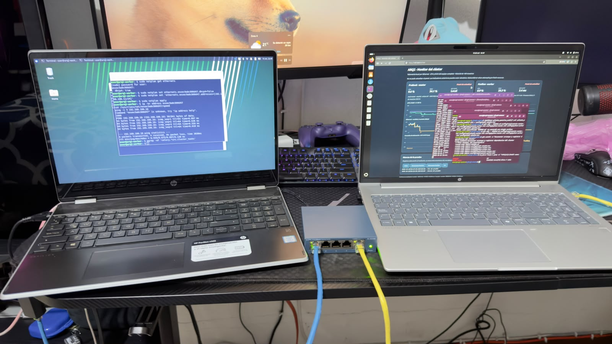

# NexoVisión — Inteligencia artificial local en clúster

Proyecto de Arquitectura de Computadoras II que distribuye la detección de objetos entre las CPUs de dos laptops Linux conectadas por Ethernet. Utiliza la cámara integrada de ProBook, YOLO11n exportado a OpenVINO y una cola compartida de Celery con Redis. Incluye monitoreo de recursos, continuidad del procesamiento ante la ausencia de Pavilion y servicios supervisados para su reincorporación al restablecer el enlace. La operación puede realizarse sin Internet una vez instaladas las dependencias y almacenado el modelo en ambos nodos.

**Autor:** Christopher José Hernández Gramajo · **Carné:** 0900-23-8598 · **Sección:** B.

**Universidad:** Universidad Mariano Gálvez de Guatemala. **Docente:** Alejandro Alberto Garcia Arrecis.

## Video e informe

- [Ver presentación y demostración en YouTube](https://youtu.be/gdchqYcIsXI).
- [Consultar el informe técnico final en PDF](docs/informe-tecnico-arq2.pdf).
- [Archivos de servicios systemd](servicios/).

El video permanece alojado en YouTube; este repositorio conserva su enlace, no el archivo de video. El informe incluye la arquitectura, las mediciones, sus limitaciones y el enlace audiovisual en el anexo D.



Las capturas de [detecciones](docs/evidencias/02-detecciones.png) y [monitoreo bajo carga](docs/evidencias/03-monitor-carga.png) complementan la documentación. El informe distingue sus valores instantáneos de las estadísticas calculadas a partir de los CSV.

## Arquitectura implementada

| Componente | ProBook / `arq2-master` | Pavilion / `arq2-worker` |
| --- | --- | --- |
| IP Ethernet estática | `192.168.100.10/24` | `192.168.100.11/24` |
| Interfaz | `enp2s0` | `enxec9a0c000d47` |
| Conexión | Ethernet a switch Gigabit | USB–RJ45 a switch Gigabit |
| Funciones | Cámara, coordinador, Redis, worker local, panel | Worker remoto y agente de telemetría |
| Modelo | `yolo11n_openvino_model/` | Copia del mismo modelo |

El switch dedicado no necesita conexión al router. No se configura gateway para la subred del clúster. El Wi-Fi es opcional durante preparación; se desactiva en ambas laptops para demostrar operación aislada de Internet.

### Servicios y protocolos

| Servicio | Dirección/puerto | Dependencias y alcance |
| --- | --- | --- |
| Redis en master | `127.0.0.1:6379/TCP` | Broker y resultados de Celery, sin exposición directa a la LAN |
| SSH en worker | `192.168.100.11:22/TCP` | Túnel inverso iniciado desde master; requiere servicio SSH de Pavilion activo |
| Redis visto desde worker | `127.0.0.1:6379/TCP` | Puerto remoto del túnel que reenvía al Redis local del master |
| Agente de telemetría | `192.168.100.11:8765/TCP`, HTTP | Solo interfaz privada; lectura de métricas mediante psutil |
| Panel de monitoreo | `127.0.0.1:8766/TCP`, HTTP | Acceso desde navegador local de ProBook |
| Cola de inferencia | `cluster` | Los dos workers consumen de la misma cola con concurrencia 1 y prefetch 1 |

El coordinador publica fotogramas JPEG codificados en base64. El worker devuelve detecciones, su hostname y tiempos. Redis se alcanza por loopback en cada laptop; en Pavilion ese acceso depende del túnel SSH supervisado por systemd. No depende de Internet ni de una terminal abierta.

## Archivos importantes

- `src/cluster_tasks.py`: aplicación Celery y tarea `arq2.infer_frame`.
- `src/coordinator.py`: cámara, envío de tareas, visualización y CSV; admite `--queue`.
- `src/send_test.py`: prueba de una imagen.
- `src/local_camera.py`: baseline local utilizado durante el desarrollo.
- `src/monitor.py`: agente/panel de monitoreo, gráficas y eventos.
- `resultados/`: CSV de pruebas y análisis Markdown.
- `config/`: inventarios de dependencias, configuración y huellas del modelo cuando se capturen.
- `docs/informe-tecnico-arq2.pdf`: informe final con enlace al video y anexos visuales.
- `docs/evidencias/`: fotografías y capturas originales del montaje, detecciones y monitoreo.
- `servicios/`: unidades systemd del túnel de ProBook y del worker y agente de Pavilion. No contienen claves privadas.
- `.venv/`: entorno de cada laptop, no se copia entre equipos ni se versiona.
- `yolo11n_openvino_model/`: modelo exportado, disponible localmente en ambas laptops. Está excluido del Git según la configuración inicial: respaldarlo aparte.

## Dependencias y reproducibilidad

Ambos equipos usan entornos Python 3.12 independientes. En las pruebas, la ProBook fue preparada con uv y Python 3.12.15; Pavilion usa Python 3.12.3 de Ubuntu 24.04. Capturar las versiones reales instaladas, sin asumir que sus paquetes son idénticos.

### Inventario en ProBook

Ejecutar en una terminal LOCAL de ProBook:

```bash
cd ~/arq2-camera
mkdir -p config
~/.local/bin/uv pip freeze --python .venv/bin/python > config/requirements-master.txt
.venv/bin/python --version > config/python-master.txt
ssh user@192.168.100.11 '/home/user/arq2-camera/.venv/bin/python -m pip freeze' > config/requirements-worker.txt
ssh user@192.168.100.11 '/home/user/arq2-camera/.venv/bin/python --version' > config/python-worker.txt
sha256sum yolo11n_openvino_model/*.xml yolo11n_openvino_model/*.bin > config/model-sha256.txt
```

Si cualquier comando falla, detenerse y resolverlo antes de versionar archivos vacíos o incompletos. Los manifiestos de `freeze` registran versiones, pero no incluyen binarios de paquetes ni aseguran que una instalación futura sin Internet pueda descargarlos. Para reinstalar offline se necesitaría un repositorio local de paquetes/wheels, además del modelo. La demostración operativa offline no requiere reinstalar el entorno.

Las dependencias principales son PyTorch CPU, torchvision, Ultralytics 8.4.177, OpenVINO, OpenCV, NumPy, Celery con soporte Redis, psutil y pandas para análisis. Instalar las variantes CPU de PyTorch desde su índice oficial; los manifiestos con versiones `+cpu` pueden requerir dicho índice al restaurar un entorno. El sistema también necesita Redis en master y OpenSSH en worker; esos servicios no quedan incluidos en `pip freeze`.

## Arranque desde equipos encendidos

El túnel, el worker de Pavilion y su agente de monitoreo están instalados como servicios systemd. El worker local, el panel y la cámara de ProBook se inician en terminales separadas. No iniciar copias manuales de procesos ya supervisados por los servicios.

### 1. Comprobaciones de red y Redis — ProBook local

```bash
ip -br address show dev enp2s0
ping -c 4 192.168.100.11
redis-cli ping
```

Redis debe responder `PONG`. Si el servicio no está activo, iniciarlo con `sudo systemctl start redis-server` y repetir la comprobación. Si la red falla, revisar direcciones, cables, switch e interfaces antes de iniciar inferencias.

### 2. Túnel y worker remoto — servicios instalados

```bash
sudo systemctl start arq2-tunnel.service
systemctl status arq2-tunnel.service --no-pager
```

Los comandos anteriores se ejecutan en ProBook. Directamente en Pavilion:

```bash
sudo systemctl start arq2-worker.service
systemctl status arq2-worker.service --no-pager
sudo journalctl -u arq2-worker.service -n 20 --no-pager
```

Comprobar conexión a Redis y tareas nuevas `received`/`succeeded`. Los servicios habilitados arrancan con el equipo. Si el túnel informa `remote port forwarding failed`, revisar en Pavilion `sudo ss -ltnp 'sport = :6379'`: una sesión anterior puede ocupar el puerto. Identificarla antes de cerrarla; no detener Redis ni terminar procesos SSH indiscriminadamente.

### 3. Worker ProBook — otra terminal LOCAL

```bash
cd ~/arq2-camera
source .venv/bin/activate
celery -A src.cluster_tasks:app worker --loglevel=INFO --concurrency=1 --hostname=master@%h --queues=cluster --prefetch-multiplier=1
```

Esperar `ready` y mantener abierto.

### 4. Agente de monitoreo — servicio en Pavilion

```bash
sudo systemctl start arq2-monitor-agent.service
systemctl status arq2-monitor-agent.service --no-pager
```

No necesita una terminal abierta. Comprobar la respuesta en `http://192.168.100.11:8765/metrics`. Este agente y Celery son independientes: la ausencia de telemetría no demuestra que el worker haya dejado de procesar.

### 5. Panel — otra terminal LOCAL de ProBook

```bash
cd ~/arq2-camera
source .venv/bin/activate
python -m src.monitor dashboard --interface enp2s0
```

Abrir `http://127.0.0.1:8766` en el navegador de ProBook. Verificar que responden ambos agentes. El contador de procesos Celery no equivale a una prueba de que los workers estén listos; verificar también sus terminales o resultados.

### 6. Coordinador — otra terminal LOCAL de ProBook

```bash
cd ~/arq2-camera
source .venv/bin/activate
QT_QPA_PLATFORM=xcb python -m src.coordinator --queue cluster --timeout 30 --max-pending 2
```

Mantener foco en la ventana de cámara y pulsar `q` para terminar. Las métricas se guardan en `resultados/cluster_FECHA_HORA.csv`. Los datos de inferencia deben mostrar `arq2-master` y `arq2-worker`.

Durante las primeras tareas, cargar el modelo puede tardar mucho más que una inferencia con el modelo listo. Dejar calentar antes de medir. `QT_QPA_PLATFORM=xcb` selecciona el backend gráfico usado en las pruebas; el aviso de Wayland observado no impidió la ejecución.

## Medición y evidencia sin Internet

1. Completar descargas y comprobar presencia del modelo en ambos equipos.
2. Iniciar los servicios por las IP Ethernet anteriores, con el switch sin conexión al router.
3. Desactivar Wi-Fi en ambas laptops. Mantener todos los cables del clúster conectados.
4. Ejecutar la cámara y comprobar resultados de ambos nodos y panel local.
5. Para el caso de uso del PDF, mostrar productos apropiados (por ejemplo botellas, tazas o libros) y conservar capturas con sus etiquetas. Los CSV actuales solo cuentan detecciones; no incluyen las clases ni permiten calcular precisión.
6. Marcar Inicio/Fin en el panel y guardar captura/video del funcionamiento, conexiones y estado Wi-Fi. El CSV de inferencia por sí solo no acredita aislamiento de Internet.

El software suministrado de monitoreo no carga librerías web externas. El modelo exportado se abre desde disco. Revisar otras aplicaciones y ajustes de bibliotecas si se quiere documentar ausencia de intentos de comunicación externa; con enlaces externos físicamente deshabilitados, su comunicación no puede salir por la red del clúster.

## Prueba de fallo y recuperación

1. Calentar ambos modelos y verificar resultados de los dos workers.
2. Para la prueba de video ante ausencia del worker se utilizó `--timeout 5 --max-pending 2`, después del calentamiento. Un límite corto puede descartar tareas lentas; no usarlo como tiempo de arranque del modelo.
3. Marcar Inicio; registrar el estado normal. Marcar Desconecto Pavilion al retirar únicamente su cable Ethernet.
4. Verificar que continúan resultados de `arq2-master`, no solo que se actualiza una imagen local de la cámara.
5. Tras unos 30 segundos de desconexión, reconectar el cable y marcar Reconecto Pavilion.
6. Sin ejecutar comandos ni reiniciar procesos, observar el regreso de nuevas tareas de Pavilion y del estado Responde en el panel. Esperar hasta 60 segundos como margen del ensayo, no como garantía de recuperación.
7. Confirmar ambos retornos, marcar Fin y terminar la cámara con `q`. Si no regresan, conservar los registros y consultar los servicios antes de iniciar procesos adicionales.

En un ensayo posterior a la instalación de systemd, el operador observó el retorno automático de tareas de Pavilion aproximadamente 10 segundos después de reconectar el cable. Tras instalar el agente como servicio, se repitió la prueba y se confirmó el regreso de tareas y telemetría sin intervención manual. Los 10 segundos son una estimación del primer ensayo, no un promedio, un P95 ni un tiempo medido desde los CSV originales. No se aportaron nuevos CSV de estos ensayos para un análisis temporal independiente.

Diagnóstico: en ProBook, `sudo journalctl -u arq2-tunnel.service -n 30 --no-pager`; en Pavilion, `sudo journalctl -u arq2-worker.service -n 30 --no-pager` y `sudo journalctl -u arq2-monitor-agent.service -n 30 --no-pager`. Los keepalives detectan fallos; systemd reinicia el cliente SSH y Celery reintenta su conexión. La recuperación no es instantánea ni garantiza cada tarea pendiente.

La configuración de tareas incluye confirmación tardía y rechazo si se pierde un proceso de worker. Una pérdida de conectividad de un nodo completo no equivale a matar un hijo de Celery; la recuperación de tareas no confirmadas depende del tiempo de visibilidad de Redis (habitualmente 1 hora salvo configuración distinta). El coordinador registra resultados exitosos y puede descartar tareas vencidas. La prueba realizada demuestra continuidad de inferencia y reincorporación, no entrega garantizada de cada fotograma.

Master/coordinador, Redis y switch únicos siguen siendo puntos únicos de fallo. El alcance de la tolerancia demostrada es ausencia de un worker remoto, no alta disponibilidad completa de todos los componentes.

## Resultados obtenidos

### Continuidad — `cluster_20261016_121746.csv`

- 1,274 resultados: 1,032 de master y 242 de worker.
- Intervalo de 52.863787 s sin resultados de Pavilion.
- Dentro de ese intervalo, master completó 790 inferencias (14.94 resultados/s), sin separaciones mayores de 154.966 ms entre resultados observados.
- Se registraron resultados de Pavilion después del intervalo. La medición es una ausencia observada de resultados, no la duración exacta del corte físico.
- Análisis guardado por el usuario: `resultados/prueba-continuidad-20261016.md`.

### Carga monitorizada — `cluster_20261016_142136.csv`

- Ventana Inicio/Fin: 355.243 s; 6,561 resultados, 18.47 resultados/s.
- Master: 3,890 tareas; inferencia media 17.83 ms; RTT medio 40.78 ms; CPU media 21.04 %; RAM media 35.21 %.
- Worker: 2,671 tareas; inferencia media 45.34 ms; RTT medio 84.04 ms; CPU media 52.55 %; RAM media 27.77 %.
- Ambos agentes respondieron 355/355 muestras del intervalo y reportaron 1000 Mb/s de enlace.
- Análisis guardado por el usuario: `resultados/prueba-carga-monitorizada-20261016.md`.

Estos resultados no constituyen una comparación controlada de velocidad contra un nodo único. No equiparar los resultados/s entregados con FPS del modelo, ni RTT HTTP de telemetría con RTT de inferencia. El monitor incluye CPU de todo el equipo, no solo del modelo; no mide vatios ni consumo energético.

Los CSV nuevos del monitor contienen UTC y hora local con desplazamiento. Los CSV del coordinador usan hora local sin zona; al relacionarlos, usar la zona del master y documentarla. En el ensayo monitorizado se verificó el desplazamiento −06:00.

## Cierre y conservación

- Terminar cámara con `q`; marcar Fin y detener el panel con Ctrl+C después de guardar las evidencias. Detener el worker local con Ctrl+C una sola vez y esperar su cierre.
- Para detener el procesamiento remoto, ejecutar en Pavilion `sudo systemctl stop arq2-worker.service` y después en ProBook `sudo systemctl stop arq2-tunnel.service`. Para detener su agente, ejecutar en Pavilion `sudo systemctl stop arq2-monitor-agent.service`. Los servicios permanecen habilitados para el siguiente arranque; `stop` no equivale a `disable`.
- Guardar código, manifiestos de configuración, CSV y análisis en Git. No añadir `.venv/`, cachés ni copias `.bak` de trabajo.
- Git local no es una copia externa. Mantener una copia adicional del repositorio y del modelo en otro medio antes de una reinstalación o pérdida del disco.
- No publicar secretos, claves privadas, contraseñas ni datos de cámaras con información personal.

Guía preparada a partir de los comandos, código y evidencias de la conversación. No se ha validado aún el arranque completo desde un reinicio de ambas laptops siguiendo este documento; realizar un ensayo antes de la defensa.

## Instalación de los servicios en una restauración

Los archivos de unidad se incluyen en `servicios/` de este repositorio. Se instalan en `/etc/systemd/system/` del equipo correspondiente: `arq2-tunnel.service` en ProBook; `arq2-worker.service` y `arq2-monitor-agent.service` en Pavilion. Después de copiar cada archivo se ejecuta `sudo systemctl daemon-reload` y `sudo systemctl enable --now NOMBRE.service`.

Las unidades utilizan el usuario `user` y el proyecto `/home/user/arq2-camera`. El túnel requiere la clave privada `/home/user/.ssh/arq2_cluster`, su clave pública autorizada en Pavilion y la identidad del servidor previamente verificada en `known_hosts`. La clave privada no se incluye en el paquete ni se versiona. En otro equipo se configura una clave propia y se ajustan rutas, usuario, direcciones e interfaz antes de instalar.

El túnel utiliza `ssh -NT`, autenticación no interactiva, comprobación estricta de la identidad del servidor, keepalives de 10 segundos y dos comprobaciones fallidas. Systemd reintenta tras 5 segundos si el proceso termina. Estas opciones no establecen un plazo máximo garantizado de recuperación. El agente conserva el enlace HTTP limitado a la IP privada. Estos tres servicios no automatizan el arranque de Redis, la cámara, el panel ni el worker local de ProBook.
